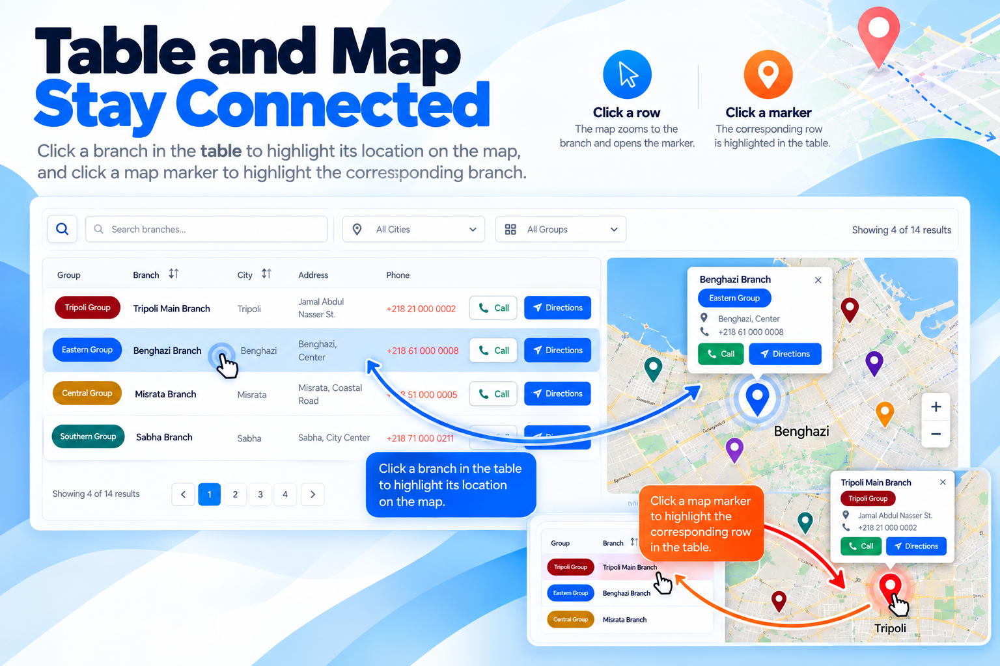

#  Kashida Branch Locator

<p align="center">
  
</p>

<p align="center">
  <strong>Find and showcase every location.</strong><br>
  Manage company branches, offices, stores, service centers, and other locations, then display them on your WordPress website using flexible, customizable layouts.
</p>

<p align="center">
  <a href="https://wordpress.org/plugins/kashida-branch-locator/"><strong>WordPress.org Plugin Page</strong></a>
  &nbsp; • &nbsp;
  <a href="https://kashida.ly/wp-plugins/kashida-branch-locator/"><strong>View Plugin on Kashida</strong></a>
  &nbsp; • &nbsp;
  <a href="https://github.com/mrwan-bg/kashida-branch-locator/releases/latest"><strong>Download Latest Release</strong></a>
  &nbsp; • &nbsp;
  <a href="https://github.com/mrwan-bg/kashida-branch-locator/archive/refs/heads/main.zip"><strong>Download Source ZIP</strong></a>
</p>

<p align="center">
  <strong>Interactive maps · Live search · City and group filters · CSV/XLSX import · RTL support</strong>
</p>

## Features

- **Multiple display layouts:** Table, Cards, List, Accordion, Map, and Map + Table.
- **Interactive map:** Display branch markers with OpenStreetMap tiles; selecting a marker and selecting a branch row stay synchronized.
- **Live search and filters:** Let visitors search by keyword and filter by city or group.
- **Sortable results:** Sort supported table columns and browse results with pagination or configured infinite scrolling.
- **Branch groups:** Organize locations into groups and assign custom group colors.
- **CSV and XLSX import:** Import branch records with a preview and optional updates to existing branches.
- **Flexible contact actions:** Display phone links and a Call button, plus a user-initiated Google Maps Directions link.
- **Responsive and multilingual-ready:** RTL/LTR-aware output, including Arabic interfaces, with typography inherited from the active theme.
- **Display Builder:** Configure the layout, fields, search, filters, sorting, pagination, map options, and actions, then generate a shortcode.
- **Privacy-conscious operation:** No analytics, advertising, telemetry, licensing checks, or developer-server tracking.

## Screenshots

### Display Builder

<p align="center">
  
</p>

### Search, filters, and sorting

<p align="center">
  
</p>

### Synchronized table and map

<p align="center">
  
</p>

### Multiple frontend layouts

<p align="center">
  
</p>

## Quick start

1. Install and activate **Kashida Branch Locator** from the WordPress dashboard, or upload the plugin folder to `/wp-content/plugins/`.
2. Open **Kashida Branch Locator** in the WordPress dashboard.
3. Add branch groups and branch locations, or import records from CSV/XLSX.
4. Use the Display Builder to configure your preferred presentation and copy its generated shortcode.
5. Add the shortcode to the page where you want the branch locator to appear.

## Shortcodes

Display all branches using the default layout:

```text
[kashida_branch_locator]
```

Choose a layout:

```text
[kashida_branch_locator layout="table"]
[kashida_branch_locator layout="cards"]
[kashida_branch_locator layout="list"]
[kashida_branch_locator layout="accordion"]
[kashida_branch_locator layout="map"]
[kashida_branch_locator layout="map-table" search="true" pagination="true"]
```

Display specific locations or groups:

```text
[kashida_branch_locator city="Tripoli"]
[kashida_branch_locator group="grp_xxxxxxxx"]
[kashida_branch_locator branch="br_xxxxxxxx"]
[kashida_branch_locator groups="grp_xxxxxxxx,grp_yyyyyyyy" layout="cards"]
[kashida_branch_locator branches="br_xxxxxxxx,br_yyyyyyyy" layout="map-table"]
```

Display a map for one group:

```text
[kashida_branch_group_map group="grp_xxxxxxxx" zoom="6" height="600"]
```

Replace example IDs with the actual branch or group IDs from your site.

## Importing branch data

CSV and XLSX files are supported directly. The import template should include these columns:

- `Name`
- `City`
- `Address`
- `Phone`
- `Lat`
- `Lng`
- `Group`

Latitude and longitude can be provided in separate `Lat` and `Lng` columns. The legacy `Location` value in `latitude,longitude` format is also supported. The maximum accepted upload size is 10 MB. Legacy `.xls` files require PhpSpreadsheet on the server; CSV or XLSX is recommended.

## Requirements

- WordPress 5.8 or later
- PHP 8.0 or later

## Maps and external services

- **OpenStreetMap:** Map tiles are requested by the visitor's browser when a map is displayed. See the [OpenStreetMap website](https://www.openstreetmap.org/), [tile usage policy](https://operations.osmfoundation.org/policies/tiles/), and [privacy policy](https://osmfoundation.org/wiki/Privacy_Policy).
- **Google Maps:** The Directions action opens Google Maps only when a visitor chooses it. See the [Google privacy policy](https://policies.google.com/privacy).

The plugin itself does not include analytics, advertising, telemetry, licensing checks, or automatic tracking, and does not contact the developer's servers for plugin operation.

## Documentation and links

- **Website:** [Kashida Media Services](https://kashida.ly/)
- **Plugin page:** [Kashida Branch Locator on Kashida.ly](https://kashida.ly/wp-plugins/kashida-branch-locator/)
- **WordPress plugin directory:** [Kashida Branch Locator](https://wordpress.org/plugins/kashida-branch-locator/)
- **WordPress readme:** [readme.txt](readme.txt)
- **License:** [GPL-2.0-or-later](https://www.gnu.org/licenses/gpl-2.0.html)

---

Designed and developed by **Kashida Media Services**.
