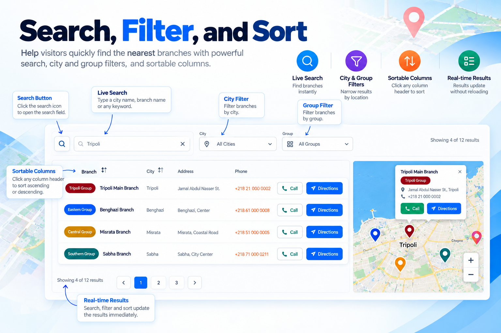
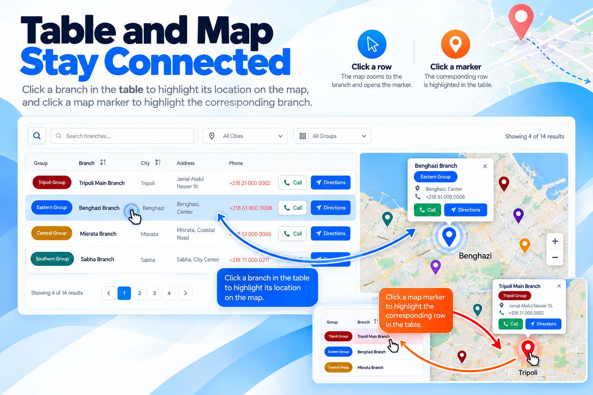
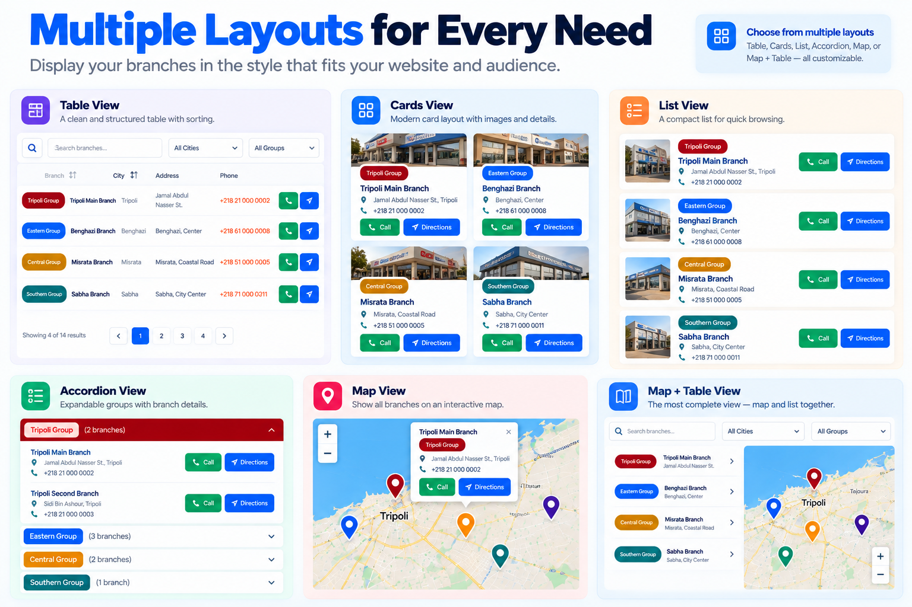

#  Kashida Branch Locator

<p align="center">
  
</p>

<p align="center">
  <strong>Find and showcase every location.</strong><br>
  Manage company branches, offices, stores, service centers, and other locations, then display them on your WordPress website using flexible, customizable layouts.
</p>

<p align="center">
  <a href="https://wordpress.org/plugins/kashida-branch-locator/"><strong>WordPress.org Plugin Page</strong></a>
  &nbsp; • &nbsp;
  <a href="https://kashida.ly/wp-plugins/kashida-branch-locator/"><strong>View Plugin on Kashida</strong></a>
  &nbsp; • &nbsp;
  <a href="https://github.com/mrwan-bg/kashida-branch-locator/releases/latest"><strong>Download Latest Release</strong></a>
  &nbsp; • &nbsp;
  <a href="https://github.com/mrwan-bg/kashida-branch-locator/archive/refs/heads/main.zip"><strong>Download Source ZIP</strong></a>
</p>

<p align="center">
  <strong>Interactive maps · Live search · City and group filters · CSV/XLSX import · RTL support</strong>
</p>


## Release and compatibility

The current plugin version is **v2.7.0**. The plugin header and WordPress readme stable tag are aligned with this version. Compatibility has been tested with WordPress 7.2 and PHP 8.6; the minimum PHP requirement remains PHP 8.0.

For installation, use the [WordPress.org plugin page](https://wordpress.org/plugins/kashida-branch-locator/) or download the [latest published GitHub release](https://github.com/mrwan-bg/kashida-branch-locator/releases/latest). The **Source ZIP** link above downloads the current `main` branch snapshot; it is not necessarily the same as a tagged release package.

The WordPress.org directory artwork is managed separately from images embedded in this GitHub README. This README uses the repository files under `assets/screens/` for its icon, banner, and screenshots.

## Features

- **Multiple display layouts:** Table, Cards, List, Accordion, Map, and Map + Table.
- **Interactive map:** Display branch markers with OpenStreetMap tiles; selecting a marker and selecting a branch row stay synchronized.
- **Live search and filters:** Let visitors search by keyword and filter by city or group.
- **Sortable results:** Sort supported table columns and browse results with pagination or configured infinite scrolling.
- **Branch groups:** Organize locations into groups and assign custom group colors.
- **CSV and XLSX import:** Import branch records with a preview and optional updates to existing branches.
- **Flexible contact actions:** Display phone links and a Call button, plus a user-initiated Google Maps Directions link.
- **Responsive and multilingual-ready:** RTL/LTR-aware output, including Arabic interfaces, with typography inherited from the active theme.
- **Display Builder:** Configure the layout, fields, search, filters, sorting, pagination, map options, and actions, then generate a shortcode.
- **Privacy-conscious operation:** No analytics, advertising, telemetry, licensing checks, or developer-server tracking.

## Screenshots

### Display Builder

<p align="center">
  
</p>

### Search, filters, and sorting

<p align="center">
  
</p>

### Synchronized table and map

<p align="center">
  
</p>

### Multiple frontend layouts

<p align="center">
  
</p>

## Quick start

1. Install and activate **Kashida Branch Locator** from the WordPress dashboard, or upload the plugin folder to `/wp-content/plugins/`.
2. Open **Kashida Branch Locator** in the WordPress dashboard.
3. Add branch groups and branch locations, or import records from CSV/XLSX.
4. Use the Display Builder to configure your preferred presentation and copy its generated shortcode.
5. Add the shortcode to the page where you want the branch locator to appear.

## Shortcodes

Display all branches using the default layout:

```text
[kashida_branch_locator]
```

Choose a layout:

```text
[kashida_branch_locator layout="table"]
[kashida_branch_locator layout="cards"]
[kashida_branch_locator layout="list"]
[kashida_branch_locator layout="accordion"]
[kashida_branch_locator layout="map"]
[kashida_branch_locator layout="map-table" search="true" pagination="true"]
```

Display specific locations or groups:

```text
[kashida_branch_locator city="Tripoli"]
[kashida_branch_locator group="grp_xxxxxxxx"]
[kashida_branch_locator branch="br_xxxxxxxx"]
[kashida_branch_locator groups="grp_xxxxxxxx,grp_yyyyyyyy" layout="cards"]
[kashida_branch_locator branches="br_xxxxxxxx,br_yyyyyyyy" layout="map-table"]
```

Display a map for one group:

```text
[kashida_branch_group_map group="grp_xxxxxxxx" zoom="6" height="600"]
```

Replace example IDs with the actual branch or group IDs from your site.

## Importing branch data

CSV and XLSX files are supported directly. The import template should include these columns:

- `Name`
- `City`
- `Address`
- `Phone`
- `Lat`
- `Lng`
- `Group`

Latitude and longitude can be provided in separate `Lat` and `Lng` columns. The legacy `Location` value in `latitude,longitude` format is also supported. The maximum accepted upload size is 10 MB. Legacy `.xls` files require PhpSpreadsheet on the server; CSV or XLSX is recommended.

## Requirements

- WordPress 5.8 or later
- PHP 8.0 or later

## Maps and external services

- **OpenStreetMap:** Map tiles are requested by the visitor's browser when a map is displayed. See the [OpenStreetMap website](https://www.openstreetmap.org/), [tile usage policy](https://operations.osmfoundation.org/policies/tiles/), and [privacy policy](https://osmfoundation.org/wiki/Privacy_Policy).
- **Google Maps:** The Directions action opens Google Maps only when a visitor chooses it. See the [Google privacy policy](https://policies.google.com/privacy).

The plugin itself does not include analytics, advertising, telemetry, licensing checks, or automatic tracking, and does not contact the developer's servers for plugin operation.

## Documentation and links

- **Website:** [Kashida Media Services](https://kashida.ly/)
- **Plugin page:** [Kashida Branch Locator on Kashida.ly](https://kashida.ly/wp-plugins/kashida-branch-locator/)
- **WordPress plugin directory:** [Kashida Branch Locator](https://wordpress.org/plugins/kashida-branch-locator/)
- **WordPress readme:** [readme.txt](readme.txt)
- **License:** [GPL-2.0-or-later](https://www.gnu.org/licenses/gpl-2.0.html)

---

Designed and developed by **Kashida Media Services**.

---

## الشرح باللغة العربية

**إضافة مواقع الفروع من كشيدة (Kashida Branch Locator)** تتيح إدارة فروع الشركات والمكاتب والمتاجر ومراكز الخدمات من لوحة تحكم ووردبريس، ثم عرضها للزوار بطرق متعددة ومتجاوبة مع مختلف أحجام الشاشات.

### طرق عرض الفروع
- **الجدول (Table):** عرض بيانات الفروع في جدول منظم.
- **البطاقات (Cards):** عرض كل فرع داخل بطاقة مستقلة.
- **القائمة (List):** عرض الفروع في قائمة رأسية.
- **الأكورديون (Accordion):** تجميع الفروع في أقسام قابلة للفتح والإغلاق.
- **الخريطة (Map):** عرض مواقع الفروع على خريطة تفاعلية.
- **الخريطة والجدول (Map + Table):** عرض الخريطة والجدول مع مزامنة تحديد الفرع بينهما.

### المميزات
- إضافة الفروع وإدارتها وتنظيمها ضمن مجموعات مع ألوان مخصصة.
- البحث والتصفية حسب الكلمات والمدينة والمجموعة.
- ترتيب النتائج وتقسيمها إلى صفحات أو استخدام التحميل اللانهائي عند تفعيله.
- استيراد بيانات الفروع من ملفات CSV وXLSX مع معاينة البيانات قبل الاستيراد.
- عرض أرقام الهاتف وروابط الاتصال والاتجاهات إلى مواقع الفروع.
- دعم اللغتين واتجاهي العرض RTL وLTR، مع وراثة الخطوط من القالب النشط.
- تخصيص طريقة العرض والحقول وأدوات البحث والتصفية من خلال أداة Display Builder، ثم إنشاء الرمز القصير لإضافته إلى صفحات الموقع.
- استخدام خرائط OpenStreetMap دون الحاجة إلى مفتاح Google Maps API.

### طريقة الاستخدام
1. ثبّت الإضافة وفعّلها من لوحة تحكم ووردبريس.
2. أضف مجموعات الفروع ثم أضف الفروع يدوياً أو استوردها من ملف CSV أو XLSX.
3. افتح Display Builder وحدد طريقة العرض والحقول وخيارات البحث والتصفية.
4. انسخ الرمز القصير الذي تم إنشاؤه وأضفه إلى الصفحة المطلوبة.

**متطلبات التشغيل:** WordPress 5.8 أو أحدث، وPHP 8.0 أو أحدث.

