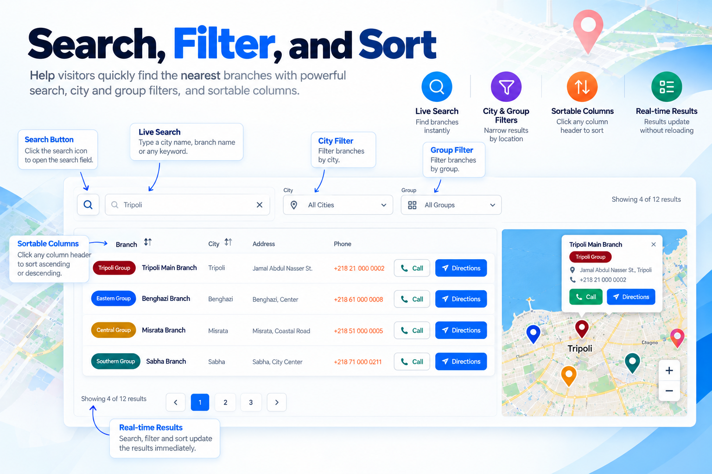
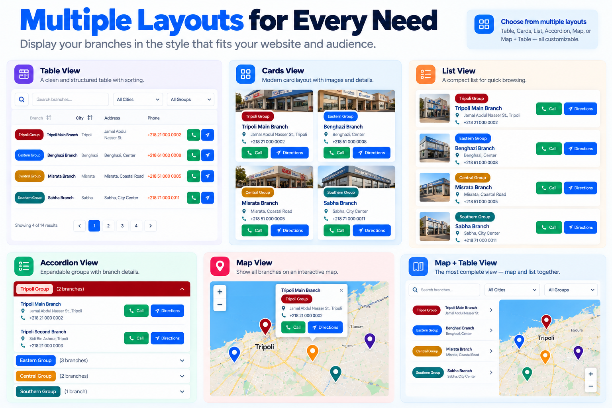

<p align="center">
  
</p>

# Kashida Branch Locator

**Kashida Branch Locator** is a lightweight WordPress plugin for managing and displaying branches, offices, stores, service centers, and other locations.

It provides organized branch directories with groups, searchable listings, city and group filters, sorting, pagination, and interactive maps. The built-in **Display Builder** helps you select branches or groups, choose a layout, configure the information shown to visitors, enable search and filters, preview the result, and generate a shortcode—without writing code.

<p align="center">
  
</p>

<p align="center">
  <strong>Current release: v2.5.22</strong><br>
  <a href="https://github.com/mrwan-bg/kashida-branch-locator/releases">Download</a> ·
  <a href="https://github.com/mrwan-bg/kashida-branch-locator/issues">Report an issue</a> ·
  <a href="https://kashida.ly/">Kashida Media Services</a>
</p>

## Features

### Six responsive display layouts

- **Table** — Structured branch listings with sortable columns.
- **Cards** — Card-based branch information.
- **List** — Compact layout for quick browsing.
- **Accordion** — Branches organized into expandable groups.
- **Map** — Branch locations on an interactive map.
- **Map + Table** — A connected branch list and map; visitors can select a branch from either view.

### Search, filters, and sorting

- Live branch search.
- City and group filters.
- Sortable table columns.
- Pagination.
- Results update without a full page reload.

### Interactive OpenStreetMap maps

- Branch location markers and information popups.
- Map and list synchronization.
- Call buttons and directions links where configured.
- Responsive mobile map interaction.
- No Google Maps API key is required for the built-in map. Visitors can choose to open directions in Google Maps.

### Branch and group management

Manage branches and reusable groups from the WordPress dashboard. Depending on the display configuration, you can show individual branches, selected groups, multiple groups, or combined branch listings using shortcodes.

### CSV and Excel import

Import branch data from **CSV** and **XLSX** files. Supported fields include:

- Branch name
- City and address
- Phone
- Latitude and longitude
- Group

The importer supports file validation, data preview, coordinate validation, warnings, and error reporting to help identify problems in imported data.

### Display Builder and shortcodes

Use the visual **Display Builder** to select branches or groups, choose a layout, configure visible fields and visitor options, preview the display, and generate the shortcode. Paste the generated shortcode into a WordPress page, post, or another shortcode-enabled area.

Example shortcodes (available options depend on the selected layout and configuration):

```text
[kashida_branch_locator]
[kashida_branch_locator layout="table"]
[kashida_branch_locator layout="cards"]
[kashida_branch_locator layout="accordion"]
[kashida_branch_locator layout="list"]
[kashida_branch_locator layout="map"]
[kashida_branch_locator layout="map-table" search="true" pagination="true"]
[kashida_branch_locator city="Tripoli"]
[kashida_branch_locator group="grp_xxxxxxxx"]
```

See [`SHORTCODE-USAGE.txt`](kashida-branch-locator/SHORTCODE-USAGE.txt) for additional examples.

## Screenshots

### Branch management


### Group management



### CSV/XLSX import


### Frontend display



## Installation

1. Download `kashida-branch-locator-v2.5.22.zip` from the [GitHub Releases](https://github.com/mrwan-bg/kashida-branch-locator/releases) page. Select the attached plugin ZIP, not GitHub's automatically generated **Source code** archives.
2. In WordPress, open **Plugins → Add New Plugin → Upload Plugin**.
3. Upload the ZIP, install it, and activate **Kashida Branch Locator**.
4. Open **Branch Locator** in the WordPress administration menu.
5. Create groups if needed, then add branches manually or import a CSV/XLSX file.
6. Add latitude and longitude coordinates for branches that should appear on the map.
7. Open **Display Builder**, choose the branches or groups, select a layout, and configure the display.
8. Generate and copy the shortcode, then paste it into a page, post, or other shortcode-enabled area.
9. Publish or update the page.

## Requirements

- **WordPress:** 5.8 or later
- **PHP:** 8.0 or later
- **Import:** CSV and XLSX supported. Legacy XLS files may require PhpSpreadsheet to be available on the server.

## Plugin information

| Property | Value |
|---|---|
| Plugin version | 2.5.22 |
| Text domain | `kashida-branch-locator` |
| License | GPL-2.0-or-later |
| Map provider | OpenStreetMap |
| Import formats | CSV and XLSX |
| Coordinates | Latitude / longitude |
| Translation | WordPress gettext; `.po`/`.mo` files; multilingual workflows including Polylang |
| Tracking / telemetry | None included |

**Tested up to:** WordPress 7.1. This value should be kept aligned with the version actually tested before each release.

## External services and privacy

Map layouts load tiles from OpenStreetMap when visitors use the map. The visitor's browser requests those tiles directly, so OpenStreetMap may receive the visitor's IP address and normal HTTP request information. If a visitor chooses the directions feature, the plugin can open Google Maps. Branch and group data are stored on the WordPress website; the plugin does not send branch data to Kashida servers. The plugin does not include analytics, advertising, telemetry, licensing checks, or automatic tracking.

- [OpenStreetMap](https://www.openstreetmap.org/)
- [OpenStreetMap tile usage and copyright](https://www.openstreetmap.org/copyright)
- [OpenStreetMap Foundation Privacy Policy](https://osmfoundation.org/wiki/Privacy_Policy)
- [Google Maps Privacy Policy](https://policies.google.com/privacy)

## Project files

- Plugin source: [`kashida-branch-locator/`](kashida-branch-locator/)
- Changelog: [`CHANGELOG.md`](CHANGELOG.md)
- Contributing guidelines: [`CONTRIBUTING.md`](CONTRIBUTING.md)
- License: [`LICENSE`](LICENSE)

## Support and contributions

- [Report a bug](https://github.com/mrwan-bg/kashida-branch-locator/issues/new?template=bug_report.md)
- [Request a feature](https://github.com/mrwan-bg/kashida-branch-locator/issues/new?template=feature_request.md)
- [View releases](https://github.com/mrwan-bg/kashida-branch-locator/releases)

## Contributors and developers

**Developer:** Mrwan elGobee  
**Organization:** Kashida Media Services  
**Website:** [https://kashida.ly/](https://kashida.ly/)  
**Behance:** [Mrwan elGobee](https://www.behance.net/Mrwan_elgobee)
